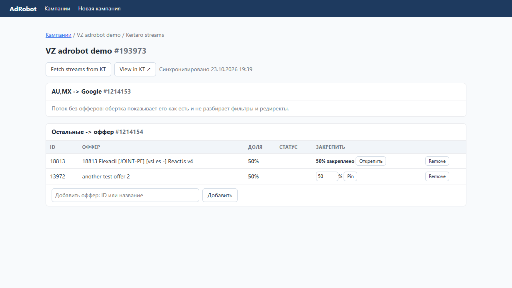
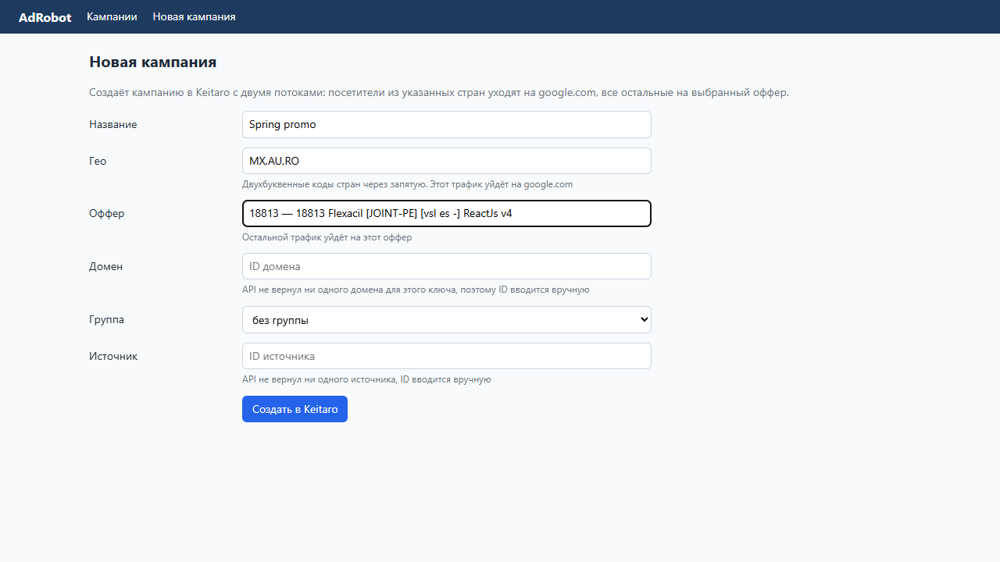

# AdRobot: обёртка над Keitaro

Тестовое задание на позицию Python-разработчика в команду AdRobot (агентство «Это Легко»).

Две части по ТЗ:

1. **Создаватор кампаний.** Принимает название, гео-коды стран и оффер. Создаёт в Keitaro кампанию с двумя потоками: первый ловит посетителей из указанных стран и редиректит на google.com, второй отправляет всех остальных на выбранный оффер. Домен, группа и источник задаются в той же форме.
2. **Редактор потоков существующей кампании.** Повторяет логику из видео: добавление и удаление офферов, пересчёт долей, закрепление долей, архив и возврат офферов, публикация в Keitaro и отмена неопубликованных правок.




## Запуск

```bash
python -m venv .venv
.venv/Scripts/activate          # Windows; на Linux/macOS: source .venv/bin/activate
pip install -r requirements.txt
cp .env.example .env            # вписать KEITARO_URL и KEITARO_API_KEY
python manage.py migrate
python manage.py runserver
```

Открыть http://127.0.0.1:8000. API-ключ создаётся в Keitaro: Профиль → API ключи.

Тесты (сценарии из видео на фейковом Keitaro, сеть не нужна):

```bash
python manage.py test
```

## Как работает редактор

Обёртка хранит у себя копию потоков и офферов кампании (SQLite) и показывает, что ещё не опубликовано.

| Действие | Что происходит |
|---|---|
| **Fetch streams from KT** | Загружает потоки из Keitaro. Keitaro здесь источник правды: неопубликованные правки сбрасываются (перед этим спрашиваем подтверждение). Офферы, о которых обёртка знала, но которых в Keitaro больше нет, не пропадают, а уходят в архив |
| Поток без офферов | Показывается как есть, его фильтры и редиректы не разбираются |
| **Добавить оффер** | Поиск по ID или названию в офферах Keitaro. Доли пересчитываются поровну, поток становится жёлтым: изменения ещё не в Keitaro |
| **Remove** | Оффер сереет, его доля становится 0%, остальные делят трафик. После публикации он пропадает из Keitaro, но остаётся у нас в архиве |
| **Bring back** | Возвращает оффер из архива, доли пересчитываются |
| **Pin** | Закрепляет долю оффера (текущую или введённую). Дальнейшие добавления и удаления пересчитывают только незакреплённые офферы |
| **Cancel** | Отменяет все неопубликованные правки потока: новые офферы удаляются, удалённые и возвращённые возвращаются в прежнее состояние, доли откатываются |
| **Push to KT** | Отправляет в Keitaro список живых офферов с долями (`PUT /streams/{id}`). Перед отправкой проверяется, что сумма долей ровно 100% |

Доли целые: при трёх офферах 33/33/34, остаток уходит последним, как в интерфейсе Keitaro. При закреплении остаток после закреплённых долей делится между остальными так же.

## Устройство

```
campaigns/
  keitaro.py    тонкий клиент Admin API v1 (requests), повтор GET/PUT при обрывах TLS
  services.py   вся логика: синхронизация, правки потока, публикация, создание кампании
  shares.py     деление процентов
  models.py     Campaign, Stream, OfferLink (статусы: active, new, removing, removed, restoring)
  views.py      тонкие вьюхи поверх services
  tests.py      сценарии из видео-ТЗ
```

Интерфейс на шаблонах Django без фронтенд-фреймворка. Подсказка офферов сделана на нативном `<datalist>`, который заполняется запросом к `/api/offers/`.

## Что заметил при работе с тестовым Keitaro

- Для тестового пользователя API возвращает пустые списки доменов, групп кампаний и источников, а создание источника запрещено правами. Поэтому в создаваторе эти поля выбираются из списка, если API что-то вернул, а иначе ID вводится вручную. Группу кампаний API создать позволяет.
- TLS-соединение с трекером время от времени обрывается (`SSLEOFError`). Клиент повторяет идемпотентные запросы, а POST не повторяет, чтобы не создать кампанию дважды.
- Список офферов кэшируется на минуту. Если офферов тысячи, поиск стоит перенести на сторону Keitaro.
